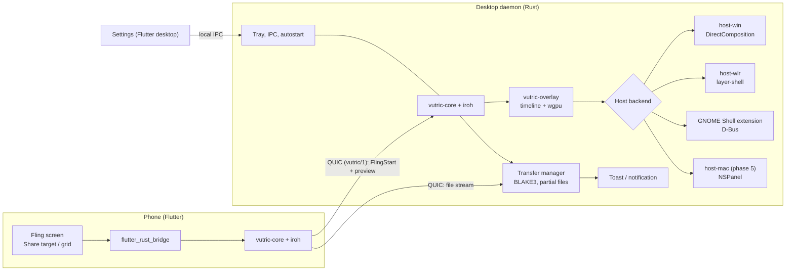

# Architecture

## Why this shape

- **Preview first.** The effect starts on a ~30 KB preview; the full file streams in parallel. A 40 MB video
  feels as instant as a photo.
- **Pure core.** Protocol, framing, pairing and file-name safety have no I/O, so they are tested exhaustively and
  shared byte-for-byte with the phone through `flutter_rust_bridge`.
- **Pure timeline.** Effects are functions of time. The renderer is a single scissored SDF pass, so a new effect is a
  timeline + a shader, testable without a GPU and portable to every host.
- **Hosts are thin.** Everything platform-specific is how a transparent, input-transparent, non-activating surface
  reaches the screen. Windows (DirectComposition), wlroots/KDE (layer-shell), GNOME (Shell extension) and macOS
  (`NSPanel`) differ only there.

Decisions and their evidence: [`decisions/`](decisions/). Measurements: [`reports/`](reports/).
